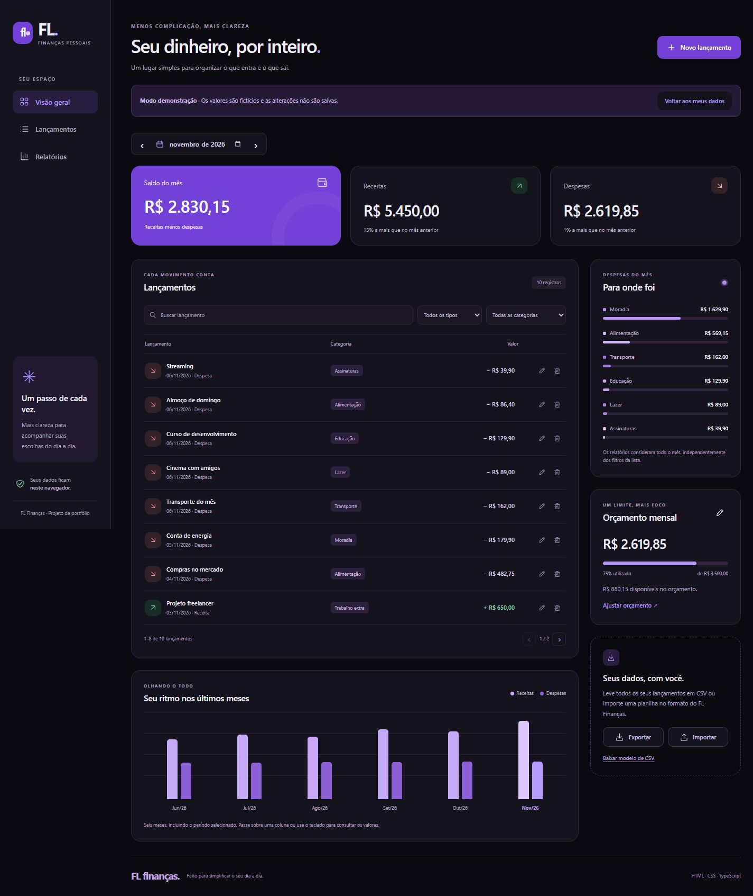

# FL Finanças

Este é um projeto meu para o meu **portfólio de apresentação**. Criei um organizador de finanças pessoais para praticar **HTML, CSS e TypeScript**, com visual preto e roxo e uma interface simples de usar.

**[Abrir o FL Finanças](https://felipe-landgraf.github.io/fl-financas/)** · [Baixar o projeto](https://github.com/Felipe-Landgraf/fl-financas/archive/refs/heads/main.zip)

## O que dá para fazer

- Cadastrar, editar e excluir receitas e despesas.
- Organizar os lançamentos por categoria e consultar cada mês.
- Acompanhar o saldo, os gráficos e o orçamento mensal.
- Importar e exportar lançamentos em CSV.

O botão **Explorar demonstração** mostra dados fictícios sem mexer nos seus registros.

## Como abrir

Use o link acima ou extraia a pasta e abra `index.html` no navegador. Pelo VS Code, abra a pasta do projeto, escolha **Abrir FL Finanças no Chrome** ou **Abrir FL Finanças no Edge** em **Run and Debug** e aperte **F5**.

O JavaScript pronto está incluído. Não precisa instalar nada ou executar comandos para usar. O código TypeScript fica na pasta `src`.

## Sobre os dados

Os dados ficam apenas neste navegador. Exporte o CSV para guardar seus lançamentos; o arquivo não inclui os orçamentos. Para importar, siga o modelo de [exemplo.csv](exemplo.csv).

## Para conferir o código

Os testes ficam em `testes` e podem ser executados com `npm test`, usando Node.js 18 ou superior. Eles conferem valores, datas, CSV, armazenamento e mudanças entre abas.

Para desenvolver em TypeScript, use `npm ci`. Depois, `npm run check` confere os tipos e `npm run build` atualiza o JavaScript. Esses passos são opcionais para quem só quer abrir o site.

---

**Felipe Landgraf** · Estudante de Desenvolvimento de Sistemas no **COTIL–Unicamp**.
